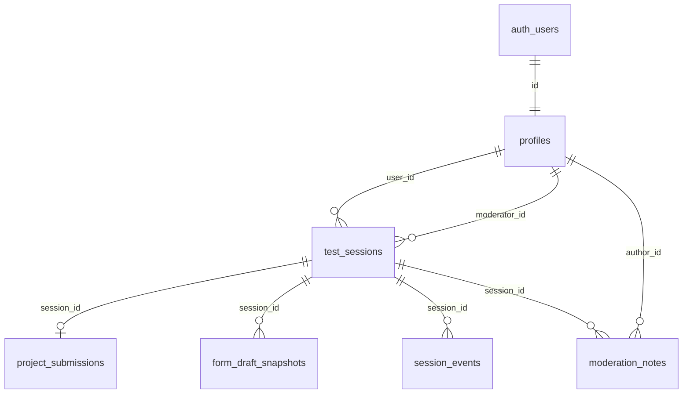

# Supabase — UXFlow research

Base de datos para la **etapa 2 (testing)**: identificar testers, registrar sesiones por pieza del flujo, envíos del formulario, abandonos y notas de moderación.

## Piezas del flujo → tablas

| Pieza (`ux_flow_piece`) | Qué persistir hoy | Tablas principales |
|-------------------------|-------------------|---------------------|
| `dashboard_publico` | Vistas, clics CTA, tiempo en landing | `test_sessions`, `session_events` |
| `formulario_inicial` | Variante A/B, pasos, envío | `test_sessions` (`flow_variant`), `session_events`, `form_draft_snapshots`, `project_submissions` |
| `post_envio` | Lectura pantalla confirmación | `test_sessions`, `session_events` (`post_envio_view`, …) |
| `recuperacion_abandonos` | Email / reingreso con borrador | `form_draft_snapshots`, `session_events`, `test_sessions` (`abandoned`) |
| `contexto_adicional` | Formulario complementario o touchpoints | `session_events`, futuras filas en `session_events` o extensión |
| `aprobacion_post_aprobacion` | Vista post-aprobación | `test_sessions`, `session_events` |

## Modelo de datos (resumen)



### JSON `company` / `project`

Misma forma que el prototipo (`prototipo/src/lib/form-storage.ts`):

- **company:** `companyName`, `organizationType`, `organizationSize`, `country`, `phoneDialCode`, `phoneNumber`
- **project:** `title`, `problem`, `challengeDescription`, `deliverables[]`, `vertical`, `sectors[]`, `stage`, `impact`, `roles[]`, `tools[]`

### Eventos sugeridos (`session_events.event_type`)

| event_type | Cuándo |
|------------|--------|
| `session_start` | Al crear `test_sessions` |
| `mode_selected` | Elegir clásico vs guiado (`payload: { variant }`) |
| `step_view` / `step_complete` | Flujo guiado (`step_id` = id en `guided-steps.ts`) |
| `screen_view` | Flujo clásico (`payload: { screen: "compania" \| "detalles" }`) |
| `validation_error` | Campo inválido |
| `submit_success` | Antes de insertar `project_submissions` |
| `post_envio_view` | Pantalla `/post-envio` |

## Crear el ambiente (primera vez)

Guía paso a paso: **[SETUP.md](./SETUP.md)** (proyecto nuevo, SQL, Vercel, `.env.local`).

## Cómo aplicar la migración

### Opción A — SQL Editor (rápido)

1. Crear proyecto en [Supabase](https://supabase.com/dashboard).
2. **Authentication → Providers → Google** (cuando integren auth).
3. **SQL → New query** → pegar contenido de  
   `migrations/20261027100000_uxflow_research_schema.sql` → **Run**.
4. Verificar con `verify.sql`.

### Opción B — Supabase CLI

```bash
npm install -g supabase
supabase login
supabase link --project-ref <TU_PROJECT_REF>
supabase db push
```

## Primer usuario researcher

Tras el primer login con Google, en SQL Editor:

```sql
update public.profiles
set role = 'researcher'
where email = 'tu-email@dominio.com';
```

Los roles `researcher` y `admin` pueden leer todas las sesiones y escribir `moderation_notes` (RLS).

## Allowlist (opcional)

```sql
insert into public.tester_invites (email, notes)
values
  ('participante1@gmail.com', 'Test moderado — Raquel'),
  ('equipo@nocountry.io', 'Interno');
```

La validación en signup (Edge Function o check en la app) se implementa en una iteración posterior; la tabla ya está lista.

## Variables de entorno (prototipo, iteración futura)

Copiar a `prototipo/.env.local` (no commitear):

```env
NEXT_PUBLIC_SUPABASE_URL=https://xxxx.supabase.co
NEXT_PUBLIC_SUPABASE_ANON_KEY=eyJ...
```

Service role solo en server / CI, nunca en el cliente.

## Privacidad

- Los envíos incluyen **PII** (teléfono, empresa). Usar proyecto Supabase dedicado a research, aviso en el guion de moderación y retención acordada con el equipo.
- No mezclar este proyecto con producción No Country.

## Referencias en el repo

- Piezas del flujo: [docs/02-testing/README.md](../docs/02-testing/README.md)
- Esquema de campos: [docs/02-testing/esquema-del-formulario-inicial/](../docs/02-testing/esquema-del-formulario-inicial/)
- Modelo detallado (este esquema): [docs/02-testing/modelo-datos-supabase.md](../docs/02-testing/modelo-datos-supabase.md)
